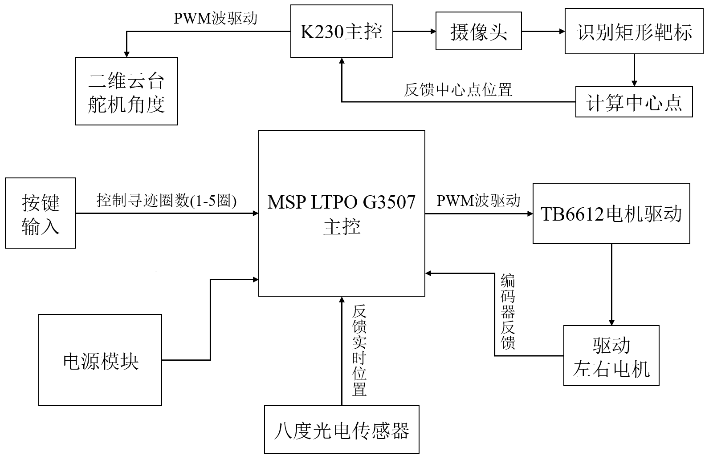
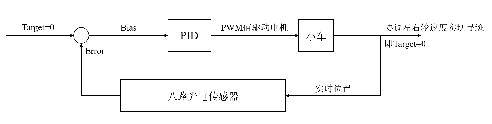
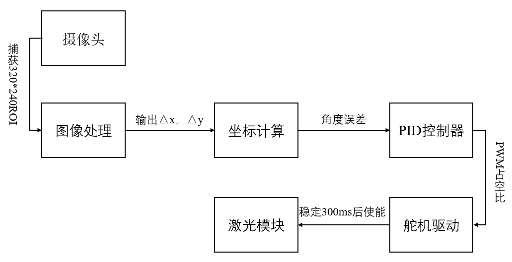
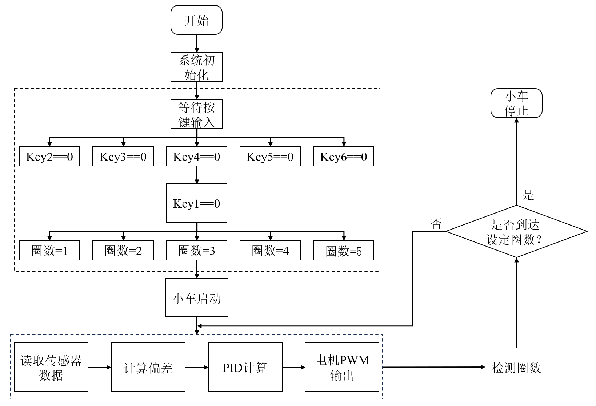
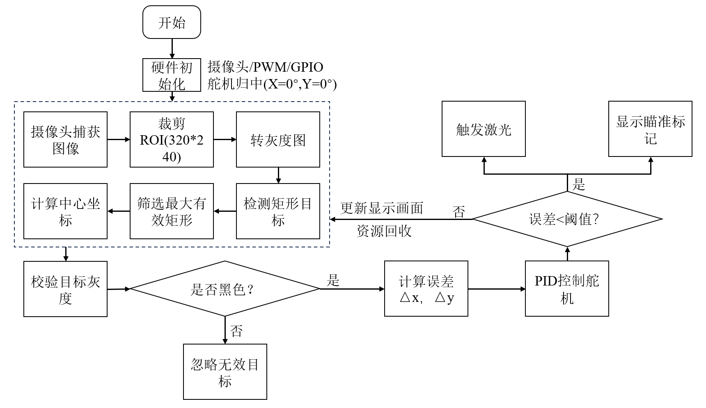
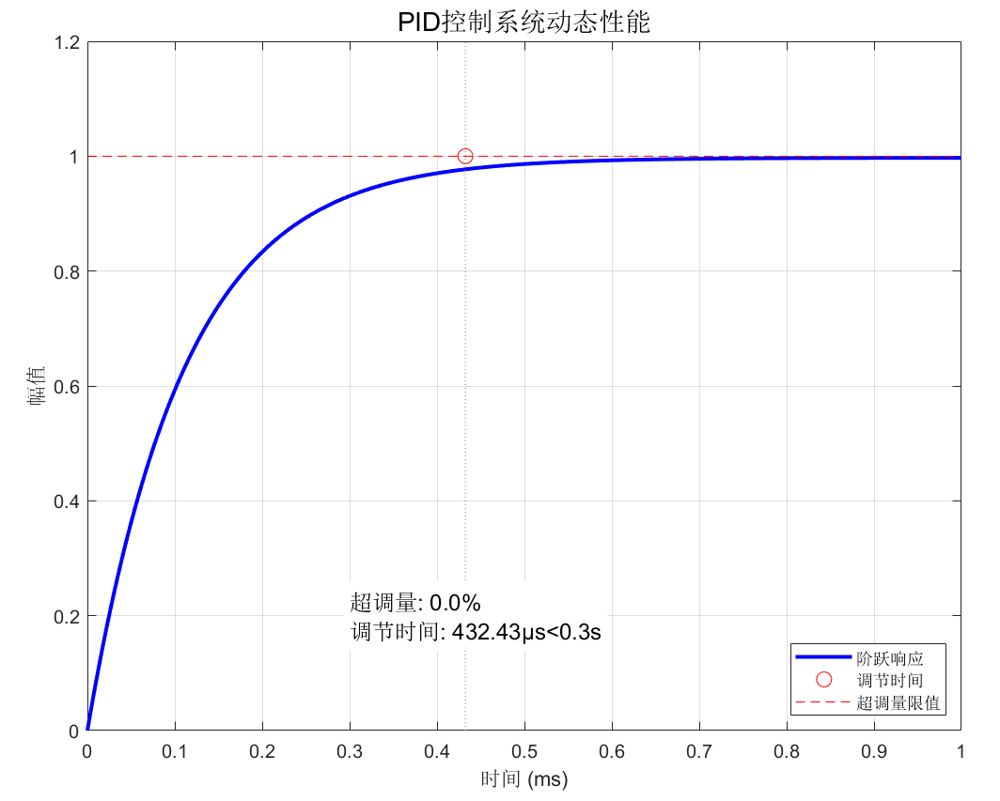

# 2025 电赛 E 题 · 简易自行瞄准装置（TI MSPM0G3507 + CanMV-K230）

[](#实测与仿真结果)
[](#硬件与双主控架构)
[](#硬件与双主控架构)
[](#仓库结构与署名边界)

> **核心定位**：**2025 年全国大学生电子设计竞赛（E 题「简易自行瞄准装置」，新疆赛区二等奖）** 系统设计文档、结构框图、MATLAB 控制仿真记录与控制方案归档。  
> **诚实边界说明**：2025 参赛板卡（TI MSPM0G3507 CCS 工程与 K230 实车脚本）因赛后存储介质未完整保留，**本仓库不伪造或拼凑 2025 赛场源码**；`references/2023-e-third-party-reference/` 下存放的 2023 年 E 题 CanMV-K230 与 STM32 代码均为**备赛期间收集研读的第三方公开参考实现（非本人原创）**。与之配套的 Python 纯算法重整与 46 项单元测试见姊妹仓库 [`k230-edge-vision-demo`](https://github.com/ffgxfvy/k230-edge-vision-demo)。

<p align="center">
  
</p>

---

## 硬件与双主控架构

系统由 **地面自动寻迹小车** 与 **视觉云台瞄准模块** 两部分构成，分别针对 TI 平台要求与实时边缘视觉约束选型：

| 子系统 | 核心硬件选型 | 关键参数与设计依据 | 控制与感知方案 |
|---|---|---|---|
| **循迹底盘主控** | **TI MSPM0G3507 + XDS110ETP** | 满足 TI 竞赛平台指定要求；片上集成调试接口与定时/PWM 外设 | 8 路光电传感器数字量输入 + 编码器反馈 + 位置式 PID 差速控制 + 1–5 圈按键设定 |
| **传感与驱动** | **8 路光电阵列 + TB6612** | 传感器间距 `d = 1.3 cm`，覆盖宽度 `W = 9.1 cm`（赛道黑线宽 `w = 1.8 cm`）；1 kHz PWM | 传感器 8 位状态映射偏差 `Bias`，驱动左右有刷电机实现平滑纠偏 |
| **边缘视觉瞄准** | **CanMV-K230（RISC-V + KPU）** | `320×240` ROI 图像采集、支持 500 万像素摄像头输入、最高 `30 fps` 处理 | 灰度裁剪 → 最大有效黑色矩形靶标提取 → 像素到云台偏转角解算 |
| **云台执行机构** | **双轴 180° 舵机云台 + 紫外激光** | `50 Hz` 标准 PWM（脉宽 `0.5–2.5 ms`）；20 cm 臂长实测 `0.05°` 步进分辨率 | 增量式 PID 闭环追踪；误差稳定满足窗口（稳定 `300 ms`）后触发紫外激光发射 |

<p align="center">
  
  
</p>

---

## 软件流程与 MATLAB 闭环仿真

- **寻迹子程序**：初始化 MSPM0G3507 时钟与定时器、读取用户设定圈数（1–5 圈），循环读取 8 路光电阵列编码映射误差并输入带积分限幅与微分滤波的位置式 PID，驱动电机差速循迹，完成设定圈数后自动停车。
- **视觉瞄准子程序**：K230 上电初始化摄像头与双轴舵机 PWM，捕获矩形靶标并计算中心偏差 `(dx, dy)`；采用增量式 PID（含 Y 轴反向补偿与死区/单步限幅）持续收敛误差，达标并稳定保持后触发紫外激光发射。

<p align="center">
  
  
</p>

在硬件联调前，基于 MATLAB/Simulink 建立了二阶对象近似模型并验证 PID 鲁棒性：在 `±20%` 参数摄动下保持超调量 `< 15%`、调节时间 `< 0.3 s`；标称闭环阶跃响应录得 **超调量 0.0%、调节时间 432.43 μs**。

<p align="center">
  
</p>

---

## 实测与仿真结果

以下数据均提取自 2025 参赛技术报告原文（[完整摘要与正文提取](docs/2025-report-raw-text.md)）：

| 测试项目 | 设计要求 / 测试条件 | 实测 / 仿真记录 |
|---|---|---|
| 光电阵列静态辨识精度 | `1000 lux` 照度下 | `0.5 mm` 级精度，响应延迟 `< 2 ms` |
| 赛道综合寻迹误差 | 直线 + S 弯实际赛道（恒温 `25°C`、40–60%RH） | **1.2 mm**（报告总结 `< 3 mm`） |
| 2 m 距离视觉激光瞄准偏差 | 320×240 ROI + 50 Hz 舵机云台 | **0.8 cm**（报告指标 `< 2 cm`） |
| 视觉识别到云台到位响应 | 从靶标检测到误差稳定 | **183 ms**（`< 200 ms`） |
| 云台角步进分辨率 | 20 cm 臂长 + DS1104Z 示波器 + 卷尺验证 | **0.05°**（周期 20 ms，脉宽 `0.5–2.5 ms`） |
| 电源轨纹波 | Fluke 87V / Rigol DS1104Z 测得 | **42 mVpp**（优于 `50 mVpp` 上限） |

---

## 仓库结构与署名边界

```
eec-auto-aiming-car/
├── README.md
├── assets/                                  # 从 2025 参赛报告提取的 6 张结构图、流程图与仿真曲线
│   ├── system_architecture_2025.png
│   ├── line_tracking_pid_loop.png
│   ├── aiming_control_loop.png
│   ├── car_flowchart_2025.png
│   ├── vision_flowchart_2025.png
│   └── pid_step_response_2025.png
├── docs/
│   ├── 2025-简易自行瞄准装置.md              # 2025 竞赛方案、理论计算与实测指标精编（链接 assets/ 图示）
│   └── 2025-report-raw-text.md              # 2025 参赛报告原文文本备份（已剔除 Word 二进制尾部噪声）
└── references/
    ├── NOTICE.md                            # 版权、未收录厂商包与第三方开源界定说明
    └── 2023-e-third-party-reference/        # 备赛研读用的第三方 2023 E 题开源参考（非本人原创）
        ├── NOTES.md                         # 对第三方参考代码的结构拆解与工程对照笔记
        ├── k230-canmv-2023/                 # 第三方 K230-CanMV 参考脚本与原始 readme.txt
        └── stm32f103-servo-2023/            # 第三方 STM32F103 Keil 参考工程
```

### 延伸与配套实现

- 若需查看可脱离嵌入式板卡运行、具备完整数值收敛单元测试（46 项 pytest）的云台视觉闭环 Python 算法模型，请移步：**[`k230-edge-vision-demo`](https://github.com/ffgxfvy/k230-edge-vision-demo)**。
