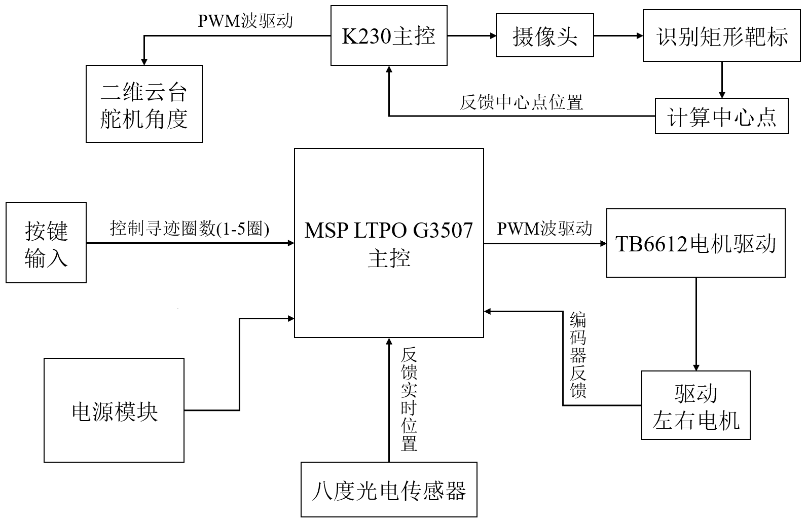
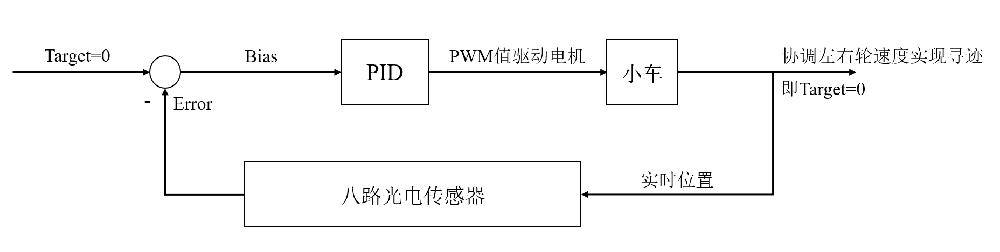
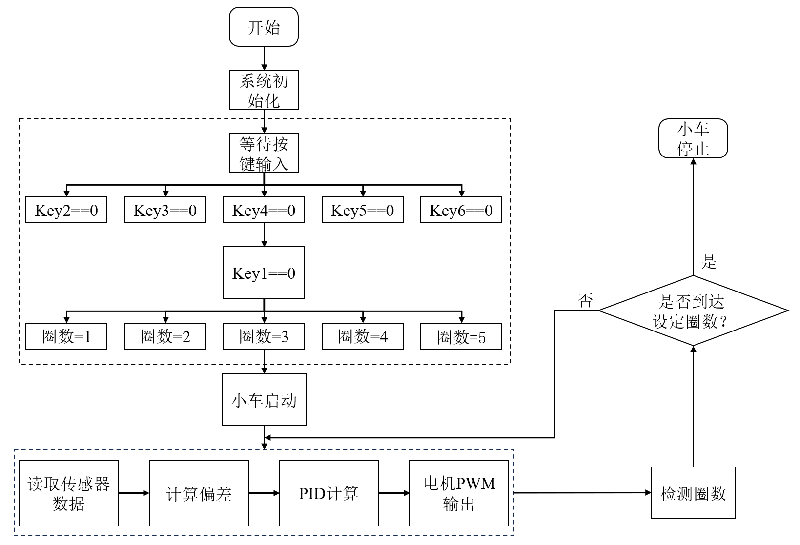
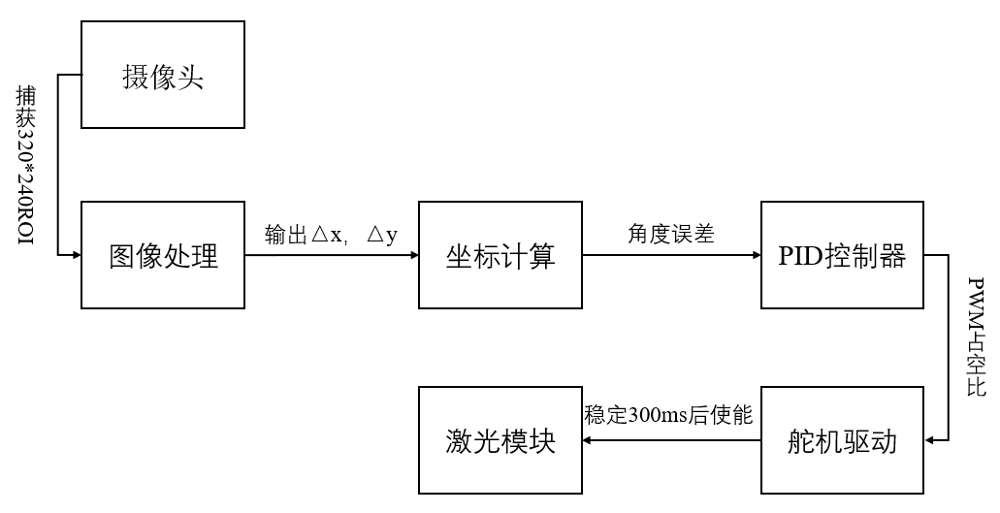
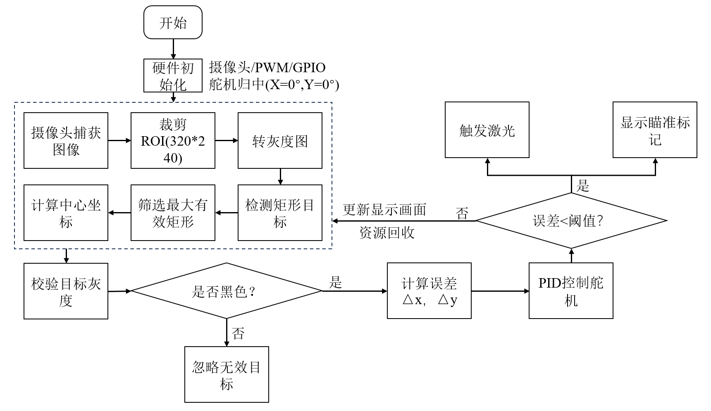
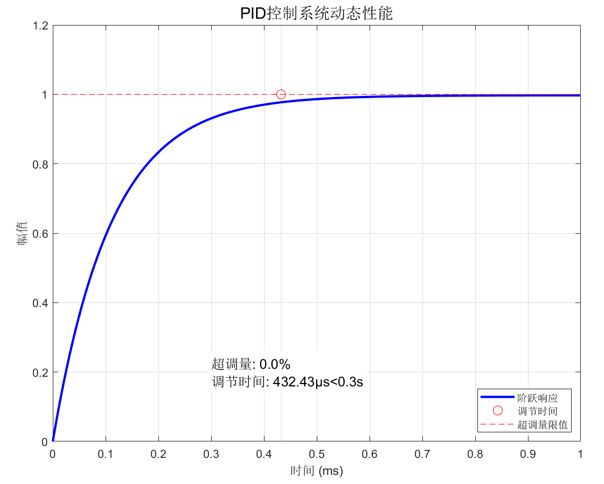

# 2025 电赛 E 题 · 简易自行瞄准装置

> 奖项：**全国大学生电子设计竞赛（2025 年）新疆赛区二等奖**  
> 原文检索备份：[2025-report-raw-text.md](2025-report-raw-text.md)（已清理 Word OLE2 尾部二进制冗余）

## 1. 系统总体框图与主控选型

系统采用 **TI MSPM0G3507 + CanMV-K230** 双主控协同架构，分离底盘高频寻迹控制与边缘视觉识别计算：

### 1.1 主控制器论证

| 方案 | 结论 |
|---|---|
| STM32F103 系列 | ❌ 性能满足基础需求，但**不符合赛题 TI 平台要求**且功耗相对偏高 |
| **TI MSPM0G3507 + XDS110ETP 调试器** | ✅ **采用**：满足 TI 平台要求，片上集成调试接口与完整外设，显著缩短调测周期 |

### 1.2 循迹传感论证

| 方案 | 结论 |
|---|---|
| 普通红外反射传感阵列 | ❌ 抗环境光干扰能力较弱，难以保障高速循迹一致性 |
| 6 轴 IMU 航位推算 | ❌ 仅依赖积分容易产生累积漂移，需多传感器融合修正 |
| **8 路光电传感器 + 数字滤波 + PID** | ✅ **采用**：`1000 lux` 照度下保持 `0.5 mm` 精度，响应延迟 `< 2 ms` |

### 1.3 瞄准视觉平台论证

| 方案 | 结论 |
|---|---|
| OV7670（30 万像素）+ OpenMV | ❌ 2 m 距离定位精度有限，整套响应较慢 |
| **CanMV-K230（RISC-V + KPU）** | ✅ **采用**：支持 500 万像素输入与 `320×240` ROI 高速处理，帧率提升至 `30 fps` |

---

## 2. 理论分析与闭环控制设计

### 2.1 寻迹模块设计

- **传感器阵列布局**：8 路光电传感器间距 `d = 1.3 cm`，阵列覆盖宽度 `W = (8 - 1) × 1.3 = 9.1 cm`，足以完整覆盖标准赛道黑线宽度 `w = 1.8 cm`。
- **位置式 PID 控制**：将 8 位二进制传感器读数 `S` 经 `switch-case` 映射为赛道偏离误差 `error`，采样周期 `T = 0.01 s`，加入积分限幅与微分滤波后输出左右轮差速 PWM（1 kHz），驱动 **TB6612FNG** 有刷电机驱动模块。
- **圈数交互**：支持按键设定 1–5 圈运行任务，编码器/光电计数达标后自动停车。

  
  

### 2.2 视觉云台瞄准设计

- **ROI 与靶标提取**：摄像头裁剪 `320×240` 有效 ROI 区域，进行灰度处理与最大有效黑色矩形筛选，计算靶心坐标 `(center_x, center_y)` 与屏幕中心像素偏差。
- **增量式 PID 云台伺服**：将像素偏差映射为双轴角度调节量（50 Hz 舵机 PWM，脉宽 `0.5–2.5 ms`，X 轴慢调、Y 轴反向补偿，带死区与单步限幅保护）；当误差达标且连续稳定 `300 ms` 后使能紫外激光模块完成打靶。

  
  

---

## 3. MATLAB 仿真与硬件实测数据

### 3.1 控制闭环 MATLAB 仿真

在 Simulink / MATLAB 中搭建二阶控制对象模型并在 `±20%` 参数摄动条件下测试 PID 鲁棒性，要求超调 `< 15%`、调节时间 `< 0.3 s`；标称闭环阶跃响应实测录得 **超调量 0.0%、调节时间 432.43 μs**。

  

### 3.2 仪器条件与实测结果

- **测试条件与仪器**：恒温 `25°C`、湿度 `40–60% RH`；使用 **Fluke 87V 数字万用表**、**Rigol DS1104Z 数字示波器**、**KEYSIGHT 33500B 信号发生器**与 **STANLEY 卷尺** 标定。
- **实测核心指标**：

| 指标 | 设计指标 / 测试条件 | 报告实测值 |
|---|---|---|
| 光电传感寻迹精度 | `1000 lux` 光照下 | **0.5 mm**（延迟 `< 2 ms`） |
| 赛道综合巡迹误差 | 直线 + S 弯赛道 | **1.2 mm**（低于 3 mm 上限） |
| 激光瞄准偏差 | `2 m` 距离打靶 | **0.8 cm**（优于 2 cm 指标） |
| 视觉—云台响应时间 | 识别到稳定打靶 | **183 ms**（`< 200 ms`） |
| 云台步进角度分辨率 | 20 cm 臂长 + PWM 脉宽测算 | **0.05°** |
| 电源纹波 | 稳压供电轨空/负载测得 | **42 mVpp**（`< 50 mVpp` 限制） |

---

## 4. 源码归档边界

比赛期间使用 **TI CCS（MSPM0G3507 C 工程）** 与 **CanMV IDE（K230 MicroPython 脚本）**。赛后未完整归档保留实车实验源码，因此本仓库仅如实展示原始参赛技术报告、系统结构框图与仿真结果，不在 2025 目录下混入或冒充其他年份参考代码。对云台 PID 数值规律的纯 Python 测试建模可查看 [`k230-edge-vision-demo`](https://github.com/ffgxfvy/k230-edge-vision-demo)。
